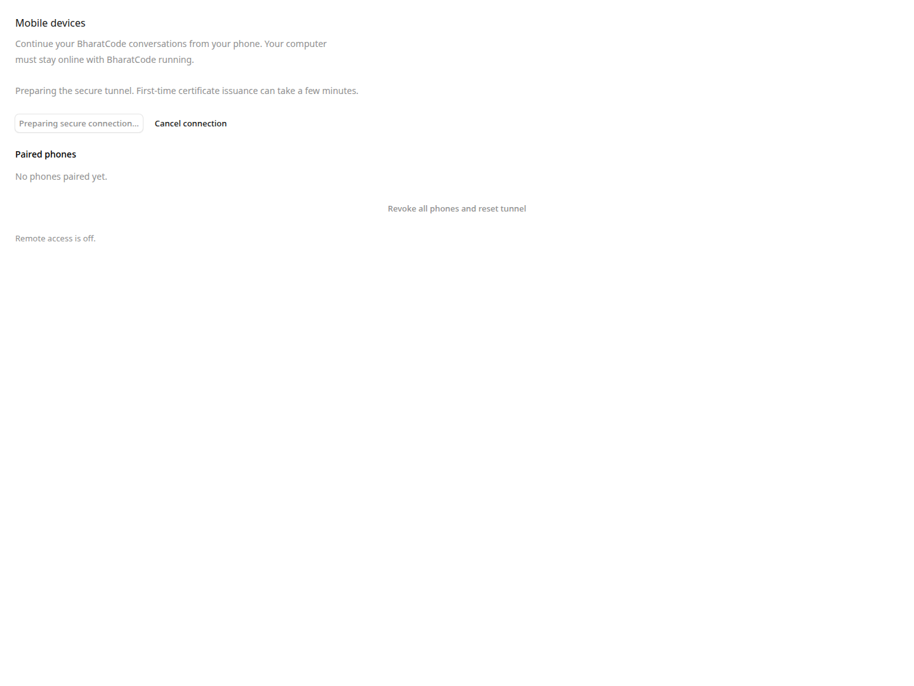
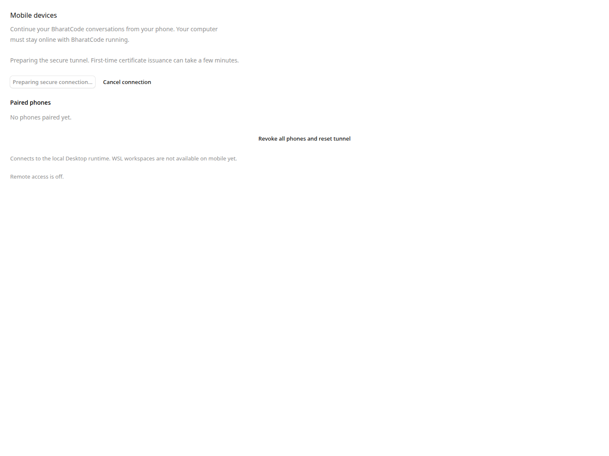

# Mobile-access follow-up, October 28, 2026

## Desktop changes

The optional mobile feature no longer reads its directory during controller construction or lets malformed/unavailable storage reject Desktop initialization. Settings reports a fixed storage error without exposing or overwriting saved data. Explicit reset preserves a private backup of a damaged registry before rebuilding it.

Reset/disable invalidate pending provisioning before entering the action queue. Queued pair and restore operations check cancellation before opening new resources. Failed persistence closes a newly opened tunnel. Settings keeps reset usable during provisioning and ignores late responses from superseded operations. File enumeration also avoids opening directories as regular files.

The pairing QR has a four-module clear border, verified from its generated PNG pixels. This rendering fix is separate from the Mobile camera initialization failure fixed by Expo Camera 58.0.13.

## Verification

Fresh October 28 checks passed: 52 connector tests; 168 Desktop tests; Desktop package and release typechecks; two generator tests and three Linux browser-helper tests in the Mobile companion. The earlier renderer qualification passed five settings Playwright cases, 55 browser tests, 30 sidecar route tests, and app/e2e typechecks.

The earlier app unit run had 748 passes and one Arabic translation-parity failure reproduced on the clean base, involving four existing `ui.message.outputLimit` keys. No unrelated translations were changed and no failure was suppressed. Earlier detailed results remain in [the October 25 report](mobile-access-verification-2026-10-25.md).

## Settings renderer fixtures

These screenshots render the production SettingsMobile component with the same isolated Playwright fixture (1440 × 1080, fake IPC response, and a held pending Pair request). The before image uses the original PR #60 head d9d6c3c; Reset is disabled during provisioning. The after image uses the reliability-fix renderer from 6331ba9; Reset remains available to cancel provisioning. Both are synthetic renderer evidence only: no Desktop profile, sidecar, tunnel, phone, camera, QR image, or pairing payload was used.

## Physical Android result

On October 28, the user scanned the installed Desktop QR with a OnePlus CPH2691 running Android 17. The phone reached matching-code approval, the user approved on Desktop, and real Desktop conversations loaded. This was a physical camera scan and user-operated approval, rather than a pasted link or an automated IPC approval.

The phone ran the separate `BharatCode Camera QA` package, built from Mobile source `0d799e09a9d5a275f4958ba88eb1c8cadadfa6c4` with temporary diagnostic counters and `expo-camera` built from source. R8 remained enabled. Installed APK SHA-256: `8462f4085100d318051b704bd6b345a0b992036244813115ee2fb231469f1653`. The existing installed Desktop and its existing sidecar handled pairing; this is not acceptance of a newly packaged Desktop build.

No camera images, QR contents or credentials were recorded by the counters. No phone permissions were changed by automation, and the existing app data and Desktop profile were preserved. This does not establish iOS, store signing, or all-platform release acceptance.

## Release boundary

The previous Linux AppImage was built from `6331ba9`, before the QR-border change. It must not be represented as the final artifact. Official publication follows `.github/workflows/README.md`: build an exact-source cohort, record manual platform acceptance, then publish those same accepted bytes. A source PR or the physical Mobile result above does not replace that gate.
